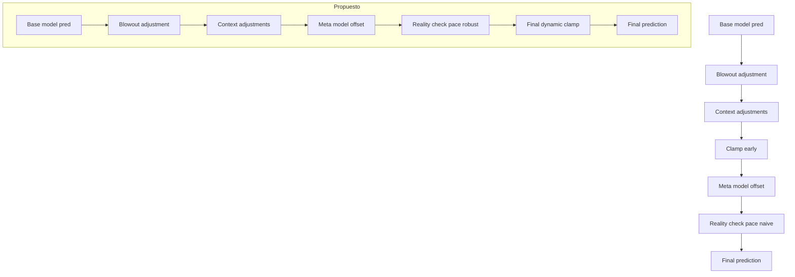

> **Vigencia documental — 18/10/2026:** fuente histórica o de alcance parcial. Sus planes, comandos y afirmaciones no definen por sí solos el sistema actual. Consultar [contraste/índice](auditoria/CONTEXTO_DOCUMENTATION.md) y [estado vigente](auditoria/00_ESTADO.md) antes de proponer cambios. El contenido original se conserva debajo.

# Plan de mitigación para predicciones infladas por pace y reality check

Resumen ejecutivo
- Incidente: la IA proyectó 269.5 con resultado 232 en un partido con Q2 anómalo.
- Causas: proyección por pace sin atenuación 12–24m, reality check tardío que elevó tras el clamp, y estado temporal incoherente en 50 por ciento de completion.
- Objetivo: robustecer projection por pace, ordenar el pipeline, y añadir límites y telemetría para evitar incrementos no realistas.

Evidencias y referencias del código
- Proyección por pace carente de atenuación 12–24m en [python._calculate_pace_based_projection()](analysis/live_mode.py:597).
- Clamp aplicado antes del reality check final en [analysis/live_mode.py](analysis/live_mode.py:819).
- Reality check tardío que puede elevar la predicción en [analysis/live_mode.py](analysis/live_mode.py:1718).
- Penalización por reality check solo definida para Q4 o desviaciones extremas en [python._apply_reality_check_penalty()](analysis/live_mode.py:618).
- Detección de quarter_stage que mapea completion 50 a q3_progress en [analysis/live_mode.py](analysis/live_mode.py:1216); telemetría asume 30m en [analysis/live_mode.py](analysis/live_mode.py:1416).
- Asignación de 30 minutos para q3_progress en métricas live en [python.calculate_live_pace_metrics()](core/live_features.py:41).

Diagrama de flujo actual y propuesto

Causa raíz detallada
- Pace projection duplicó la primera mitad sin regresión a la media cuando quedaban 24 min, generando target ~278; ver [analysis/live_mode.py](analysis/live_mode.py:597).
- El reality check tardío elevó la predicción hacia esa proyección y ocurre después del clamp de contexto; ver [analysis/live_mode.py](analysis/live_mode.py:819) y [analysis/live_mode.py](analysis/live_mode.py:1718).
- En el 50 por ciento se trató como q3_progress pese a q3_total 0, activando suposiciones de 30m en telemetría y módulos; ver [analysis/live_mode.py](analysis/live_mode.py:1216), [analysis/live_mode.py](analysis/live_mode.py:1416) y [core/live_features.py](core/live_features.py:41).

Objetivos de diseño
- Hacer que pace projection para 12–24m restantes sea conservadora, con regresión y techos.
- Evitar que cualquier módulo eleve la predicción sin tope después del clamp.
- Alinear quarter_stage con time_info y datos de marcador.
- Añadir telemetría y bloqueos que eviten uplifts no razonables.

Cambios propuestos por componente
1) Clamp final dinámico al cierre del pipeline
   - Reaplicar clamp tras reality check tardío y meta-modelo.
   - Límites: ±2 si quarter_stage q4_progress y current_lead <= 10; ±4 en otros casos; alternativa basada en desviación estándar: ±0.6σ y mínimo 2.
   - Ubicación: al final de get_predictions_with_alerts justo antes de imprimir Evolucion de la Prediccion.
   - Referencias: clamp actual en [analysis/live_mode.py](analysis/live_mode.py:819).

2) Reality check tardío solo penalizador o bidireccional con cap
   - Si final_prediction < pace_projection por mas de 20, no subir mas de +2 a +3 puntos.
   - Siempre re-clampar tras aplicar el ajuste.
   - Registrar intento de uplift >4 y bloquearlo.
   - Referencia del bloque: [analysis/live_mode.py](analysis/live_mode.py:1718).

3) Proyección por pace robusta para 12–24m restantes
   - En [python._calculate_pace_based_projection()](analysis/live_mode.py:597):
     - Para remaining_minutes entre 12 y 24 aplicar factor de atenuación por liga:
       - NBA: 0.92–0.94; WNBA/NBL: 0.90–0.92.
     - Regresión a la media: combinar 60 por ciento proyección pace con 40 por ciento baseline de liga o team_trends.h2h si disponible.
     - Techo: min de percentil 95 de totales por liga, media_equipo_2h + 2σ, y prediction_base + 20.
   - Parámetros configurables en config.

4) Corrección de quarter_stage al 50 por ciento
   - Si completion_percentage == 50 y q3_total == 0, forzar halftime.
   - Solo pasar a q3_progress cuando exista q3_total > 0 o time_info indique minutos Q3.
   - Referencia: detección en [analysis/live_mode.py](analysis/live_mode.py:1216).

5) Supresión de anomalías entre cuartos
   - Detectar Q2 anómalo: q2_total > q1_total + 2σ o diferencia > 20.
   - Reducir expected remaining pace 10–15 por ciento y elevar alerta técnica.
   - Apoyarse en quarter_variance y live_momentum_shift existentes; ver [core/live_features.py](core/live_features.py:80) y [core/live_features.py](core/live_features.py:81).

6) Telemetría y salvaguardas
   - Loggear: pace_projection, prediction_before_rc, adjustment_applied, final_clamp_aplicado.
   - Emitir alerta UNREALISTIC UPLIFT BLOCKED cuando el uplift intentado supere 4.
   - Añadir alerta de GAP extrema si abs(prediction - pace_projection) > 30 ya existe; extender con stage y remaining_minutes; ver [analysis/live_mode.py](analysis/live_mode.py:1765).

Métricas de aceptación
- Reducción de casos con uplift tardío >4 a 0 por ciento en muestreo de 200 partidos.
- Error absoluto medio en partidos con HT >= 130 reduce al menos 15 por ciento.
- Ninguna regresión en partidos con HT normal 100–120: delta MAE < 2 por ciento.

Plan de pruebas
- Unit tests:
  - HT=139, q3_total=0, completion 50 debe quedar halftime; clamp final limita y reality check no eleva >3.
  - Q2 anómalo con quarter_variance alta reduce pace projection en 12–24m.
  - Q4 cerrado aplica clamp ±2.
- Tests de integración:
  - Reproducir logs del caso reportado y verificar pred final dentro de [base_pred, base_pred+4].
  - Simulaciones de 100 juegos sintéticos con distintos HT y variancias.

Rollout
- Fase 1: mover clamp final y limitar reality check tardío.
- Fase 2: atenuación 12–24m y regresión a la media.
- Fase 3: supresión de anomalías y telemetría extendida.
- Cada fase con flag de configuración y experimento A/B si se desea.

Riesgos y mitigaciones
- Exceso de conservadurismo en partidos de alta varianza real: mantener caps por liga y permitir override por config.
- Falsos negativos en partidos realmente explosivos: techo percentil 95 combinado con σ del modelo.

Checklist de implementación
- [ ] Reaplicar clamp final al cierre del pipeline.
- [ ] Limitar reality check tardío a cap +3 y re-clamp.
- [ ] Añadir atenuación 12–24m con regresión y techo p95.
- [ ] Corregir lógica completion 50 a halftime cuando q3_total 0.
- [ ] Detector de Q2 anómalo y reducción de pace.
- [ ] Telemetría y alerta de uplift bloqueado.
- [ ] Suite de tests unitarios e integración.

Referencias rápidas
- Pace projection: [python._calculate_pace_based_projection()](analysis/live_mode.py:597)
- Clamp actual: [analysis/live_mode.py](analysis/live_mode.py:819)
- Reality check tardío: [analysis/live_mode.py](analysis/live_mode.py:1718)
- Penalización Q4: [python._apply_reality_check_penalty()](analysis/live_mode.py:618)
- Quarter stage con 50 por ciento: [analysis/live_mode.py](analysis/live_mode.py:1216)
- Telemetría Q3 progreso: [analysis/live_mode.py](analysis/live_mode.py:1416)
- Q3 minutes_played 30: [python.calculate_live_pace_metrics()](core/live_features.py:41)