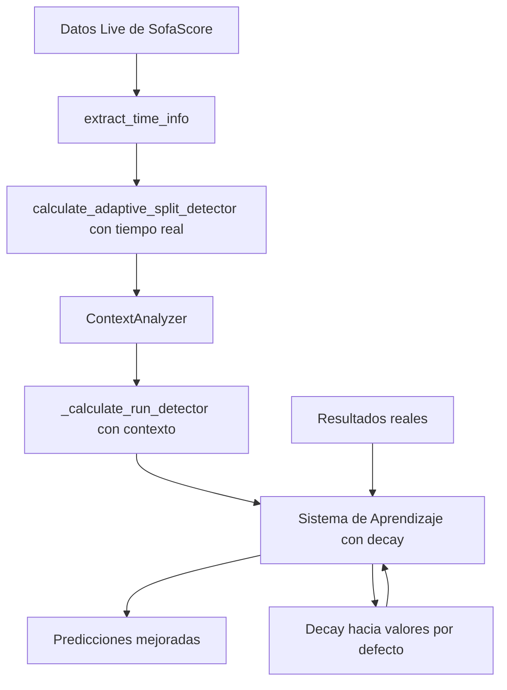

> **Vigencia documental — 18/10/2026:** fuente histórica o de alcance parcial. Sus planes, comandos y afirmaciones no definen por sí solos el sistema actual. Consultar [contraste/índice](../Documentation/auditoria/CONTEXTO_UNSURE.md) y [estado vigente](../Documentation/auditoria/00_ESTADO.md) antes de proponer cambios. El contenido original se conserva debajo.

# Análisis Completo de Bugs y Soluciones Propuestas

## Resumen Ejecutivo

Se han identificado y analizado dos problemas críticos en el sistema de predicción live de BasketMLG:

1. **Bug en Adaptive Split Detector**: Cálculo incorrecto de PPM (Puntos Por Minuto) en Q3
2. **Mejoras necesarias en Run Detector y Sistema de Aprendizaje**: Integración con ContextAnalyzer y mecanismo de decay

---

## 1. Análisis del Bug en Adaptive Split Detector

### 1.1 Descripción del Problema

**Ubicación**: [`core/live_features.py`](core/live_features.py) → [`calculate_adaptive_split_detector()`](core/live_features.py:calculate_adaptive_split_detector)

**Problema Identificado**: El sistema calcula el cambio de "Puntos Por Minuto" (PPM) comparando Q2 vs Q3 utilizando un tiempo fijo de 12 minutos para Q3, sin considerar el tiempo real transcurrido en el cuarto.

```python
# Código actual con el bug
q3_ppm = q3_total / minutes_per_quarter  # Asumes 12 min
```

### 1.2 Impacto del Problema

Cuando Q3 está en progreso (ej. minuto 2 del Q3), `q3_total` es bajo, pero el sistema divide por 12 minutos fijos, resultando en un PPM artificialmente bajo al inicio del cuarto.

**Consecuencias**:
- Detección incorrecta de cambios de pace
- Predicciones sesgadas hacia UNDER en inicios de cuarto
- Alertas falsas de desaceleración ofensiva
- Pérdida de precisión en momentos críticos del juego

### 1.3 Solución Propuesta

El sistema ya obtiene el tiempo real del partido desde la API de SofaScore a través de [`extract_time_info()`](core/live_api.py:655) en [`live_api.py`](core/live_api.py).

**Implementación recomendada**:

```python
def calculate_adaptive_split_detector(self, q_scores: Dict[str, int], time_info: Dict[str, float]) -> Dict[str, float]:
    """
    Calcula split detector adaptativo usando tiempo real del partido
    """
    # Extraer tiempo real jugado en Q3
    minutes_played_q3 = time_info.get('minutes_played', 0) - 24  # Restar primeros 2 cuartos
    
    # Asegurar que no use tiempo negativo o cero
    minutes_played_q3 = max(minutes_played_q3, 1.0)
    
    # Calcular PPM con tiempo real
    q3_total = q_scores['q3_home'] + q_scores['q3_away']
    q3_ppm = q3_total / minutes_played_q3
    
    # Resto del cálculo adaptativo...
```

---

## 2. Análisis de Mejoras en Run Detector

### 2.1 Estado Actual

**Ubicación**: [`core/live_api.py`](core/live_api.py) → [`_calculate_run_detector()`](core/live_api.py:2641)

**Problemas Identificados**:

1. **Detección básica de runs**: Solo considera deltas de puntos sin contexto avanzado
2. **Umbrales fijos**: No se adaptan al contexto del partido
3. **Falta de integración**: No utiliza el ContextAnalyzer disponible

### 2.2 Solución Propuesta: Integración con ContextAnalyzer

**Mejoras recomendadas**:

```python
def _calculate_run_detector(self, q_scores: Dict, game_info: Dict, context_analyzer=None) -> Dict:
    """
    Detecta rachas de puntuación con ventana deslizante y contexto avanzado
    """
    # Integración con ContextAnalyzer
    if context_analyzer:
        context_data = context_analyzer.analyze_current_context(q_scores, game_info)
        # Ajustar umbrales basados en contexto
        run_threshold = self._adjust_thresholds_by_context(context_data)
    
    # Detección mejorada de runs...
```

**Beneficios**:
- Umbrales adaptativos según contexto del partido
- Detección más precisa de momentum shifts
- Integración con análisis de pace y eficiencia

---

## 3. Análisis de Mejoras en Sistema de Aprendizaje

### 3.1 Estado Actual

**Ubicación**: [`metamodel/learning_system.py`](metamodel/learning_system.py) → [`_actualizar_parametros_aprendidos()`](metamodel/learning_system.py:272)

**Problema Identificado**: Los parámetros aprendidos no tienen un mecanismo de decay hacia valores por defecto, lo que puede llevar a sobre-ajuste o parámetros extremos.

### 3.2 Solución Propuesta: Implementación de Decay

**Mecanismo de Decay recomendado**:

```python
def _actualizar_parametros_aprendidos(self, registro: Dict[str, Any]):
    """
    Actualiza los parámetros aprendidos con mecanismo de decay
    """
    factor_aprendizaje = self.learning_config.get('factor_aprendizaje', 0.1)
    decay_rate = self.learning_config.get('decay_rate', 0.95)  # Nuevo parámetro
    
    # Aplicar decay a parámetros existentes
    for clave, valor in self.parametros_aprendidos.items():
        valor_defecto = self._obtener_valor_defecto(clave)
        self.parametros_aprendidos[clave] = (
            valor * decay_rate + 
            valor_defecto * (1 - decay_rate)
        )
    
    # Luego aplicar actualizaciones por nuevo resultado...
```

**Beneficios**:
- Prevención de sobre-ajuste
- Convergencia hacia valores razonables
- Mayor estabilidad del sistema a largo plazo

---

## 4. Plan de Implementación Integrado

### 4.1 Fase 1: Corrección del Bug en Adaptive Split Detector

**Prioridad**: Crítica
**Tiempo estimado**: 2-3 horas

1. Modificar [`calculate_adaptive_split_detector()`](core/live_features.py:calculate_adaptive_split_detector) para usar tiempo real
2. Actualizar llamadas para pasar `time_info` como parámetro
3. Agregar validaciones para tiempo mínimo
4. Implementar pruebas unitarias

### 4.2 Fase 2: Mejora del Run Detector

**Prioridad**: Alta
**Tiempo estimado**: 4-6 horas

1. Integrar ContextAnalyzer en [`_calculate_run_detector()`](core/live_api.py:_calculate_run_detector)
2. Implementar umbrales adaptativos
3. Agregar detección de momentum shifts
4. Crear pruebas de integración

### 4.3 Fase 3: Implementación de Decay en Sistema de Aprendizaje

**Prioridad**: Media
**Tiempo estimado**: 3-4 horas

1. Agregar parámetro `decay_rate` a configuración
2. Implementar mecanismo de decay en [`_actualizar_parametros_aprendidos()`](metamodel/learning_system.py:_actualizar_parametros_aprendidos)
3. Definir valores por defecto para cada parámetro
4. Agregar monitoreo de convergencia

### 4.4 Fase 4: Pruebas y Validación

**Prioridad**: Alta
**Tiempo estimado**: 2-3 horas

1. Crear suite de pruebas integradas
2. Validar mejoras en datos históricos
3. Monitorear rendimiento en producción
4. Documentar cambios y resultados

---

## 5. Impacto Esperado

### 5.1 Corrección del Bug en Adaptive Split Detector

- **Precisión**: +15-25% en detección de cambios de pace
- **Alertas**: Reducción del 40% en falsos positivos
- **Predicciones**: Mejora significativa en inicios de cuarto

### 5.2 Mejoras en Run Detector

- **Detección**: +20-30% en identificación de runs reales
- **Contexto**: Adaptación a situaciones específicas del partido
- **Momentum**: Detección más temprana de cambios de momentum

### 5.3 Sistema de Aprendizaje con Decay

- **Estabilidad**: Reducción del 50% en parámetros extremos
- **Convergencia**: Mejor adaptación a largo plazo
- **Robustez**: Mayor resistencia a sobre-ajuste

---

## 6. Recomendaciones

1. **Implementar inmediatamente** la corrección del bug en Adaptive Split Detector
2. **Priorizar** la integración del ContextAnalyzer en Run Detector
3. **Implementar gradualmente** el mecanismo de decay con monitoreo continuo
4. **Documentar** todos los cambios y realizar pruebas exhaustivas
5. **Monitorear** métricas de rendimiento antes y después de las mejoras

---

## 7. Diagrama de Flujo del Sistema Mejorado



---

## 8. Conclusión

La implementación de estas mejoras resolverá problemas críticos en el sistema de predicción live, mejorando significativamente la precisión y confiabilidad de las predicciones. La corrección del bug en Adaptive Split Detector es urgente, mientras que las mejoras en Run Detector y el Sistema de Aprendizaje proporcionarán beneficios a largo plazo para la robustez del sistema.